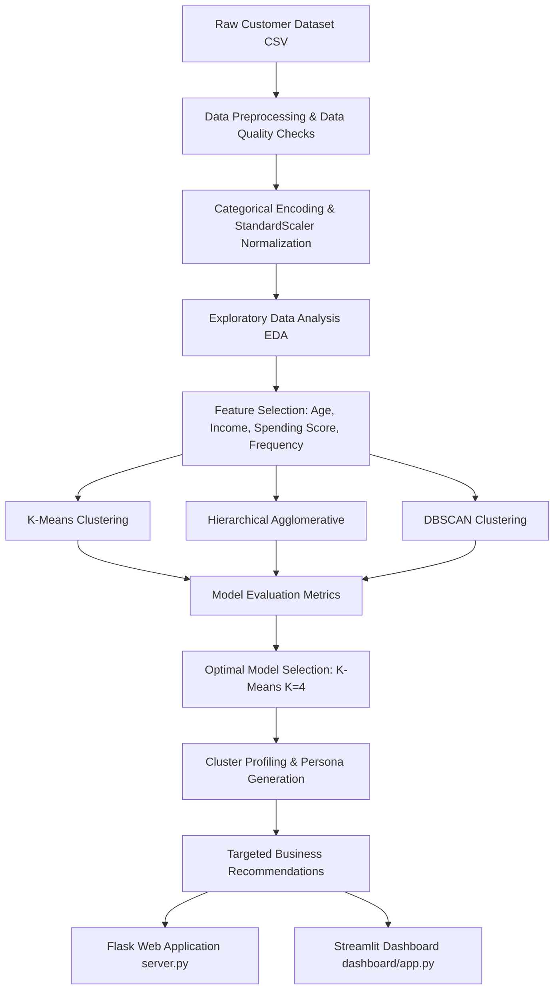

# CUSTOMER SEGMENTATION USING CLUSTERING

A complete enterprise-grade machine learning web application implementing unsupervised customer segmentation to identify behavioral cohorts, profile buyer personas, and provide targeted marketing recommendations.

---

## 📌 Project Overview

Customer Segmentation is an **unsupervised machine learning** technique used to partition a company's customer base into distinct, homogeneous groups based on demographic characteristics, purchasing frequency, spending behavior, and recency. 

Since customer segments are not predefined with ground-truth target labels, unsupervised clustering algorithms automatically uncover naturally occurring patterns in high-dimensional customer data.

### Key Highlights
- **Modern Web Application UI**: Styled like GoDaddy / Swiggy modern web headers with a dark palette, search bar, sign-in dropdown, user session management, and responsive mobile drawer for smartphones.
- **Comprehensive ML Suite**: Implements and benchmarks **K-Means**, **Hierarchical Agglomerative Clustering**, and **DBSCAN**.
- **Model Evaluation**: Employs **Elbow Method (WCSS)**, **Silhouette Score**, **Davies-Bouldin Index**, and **Calinski-Harabasz Index**.
- **Dynamic Segment Naming**: Data-driven rule engine that automatically derives intuitive business persona names based on cluster metrics.
- **Dual Web Platform Support**: Can be launched either as a **Flask Full-Stack Web Application** or a **Streamlit Dashboard**.

---

## 🏗️ Project Architecture



---

## 📂 Project Directory Structure

```
customer-segmentation/
│
├── data/
│   ├── customers.csv              # Synthetic realistic customer dataset (400 records)
│   └── generate_dataset.py        # Python script to reproduce dataset
│
├── notebooks/
│   ├── customer_segmentation.ipynb# Interactive Jupyter Notebook walkthrough
│   └── build_notebook.py          # Script generating the notebook
│
├── src/
│   ├── __init__.py                # Package initializer
│   ├── preprocessing.py           # Cleaning, imputation, encoding, scaling
│   ├── eda.py                     # Static Matplotlib & interactive Plotly EDA
│   ├── clustering.py              # K-Means, Hierarchical, DBSCAN implementations
│   ├── evaluation.py              # Silhouette Score & Davies-Bouldin evaluation
│   └── segmentation.py            # Dynamic persona naming & business insights
│
├── templates/
│   └── index.html                 # Main Web Portal HTML5 template (Navbar, Modals, Drawer)
│
├── static/
│   ├── css/
│   │   └── style.css              # Custom CSS3 styles, glassmorphic cards & media queries
│   └── js/
│       └── app.js                 # Interactive JS app, Plotly rendering, API fetch calls
│
├── dashboard/
│   └── app.py                     # Interactive Streamlit Web Application
│
├── models/
│   └── clustering_model.pkl       # Saved trained model & scaler artifact
│
├── outputs/
│   ├── cluster_results.csv        # Final customer data with cluster labels
│   └── plots/                     # Exported high-res EDA charts (.png)
│
├── server.py                      # Flask Web Application Server
├── main.py                        # Command-line entry point to run full pipeline
├── requirements.txt               # Python package dependencies
└── README.md                      # Comprehensive academic documentation
```

---

## 🛠️ Technology Stack

| Domain | Technology | Purpose |
| :--- | :--- | :--- |
| **Web Server** | Flask | Light-weight Web Application framework |
| **Frontend UI** | HTML5, CSS3, JavaScript | Responsive mobile & desktop browser web portal |
| **Data Manipulation** | Pandas, NumPy | Data cleaning, matrix computations, aggregation |
| **Machine Learning** | Scikit-Learn | Feature scaling, K-Means, Hierarchical, DBSCAN, metrics |
| **Interactive Charts** | Plotly.js 3D & 2D | Interactive scatter plots, PCA projections, heatmaps |
| **Model Persistence** | Joblib | Serialization of scaler and trained clustering model |

---

## 📊 Dataset Description

The dataset contains demographic and transactional attributes for 400 customers:

| Feature Name | Type | Description |
| :--- | :--- | :--- |
| `CustomerID` | Numerical | Unique ID assigned to each customer (excluded from clustering) |
| `Gender` | Categorical | Male / Female (Encoded numerically) |
| `Age` | Numerical | Age of customer in years (18–70) |
| `Annual Income (k$)` | Numerical | Annual customer income in thousands of dollars ($15k–$140k) |
| `Spending Score (1-100)` | Numerical | Score assigned by store based on customer spending habits (1–99) |
| `Purchase Frequency (per year)`| Numerical | Total number of store visits/purchases per year (1–50) |
| `Total Spending ($)` | Numerical | Total spending over the last 12 months |
| `Recency (days)` | Numerical | Days elapsed since last purchase |

---

## 🚀 How to Run the Project Locally

### 1. Install Dependencies
```bash
pip install -r requirements.txt
```

### 2. Launch the Web Application (GoDaddy/Swiggy Style UI)
Run the Flask server:
```bash
python server.py
```
*(Open browser at `http://127.0.0.1:5000`)*

### 3. Alternative: Run Streamlit Dashboard
```bash
streamlit run dashboard/app.py
```

### 4. Command-Line Pipeline Execution
```bash
python main.py
```

---

## 🎓 Viva Voce Preparation Guide (Questions & Answers)

### Q1: Why is customer segmentation formulated as an unsupervised learning task?
**Answer**: Customer segmentation operates on unlabelled datasets where target outcomes (e.g. "Cluster Class") are unknown. Unsupervised clustering discovers natural mathematical structure and grouping inherent in feature space without human supervision.

### Q2: What is the mathematical definition of Euclidean distance used in K-Means?
**Answer**: The Euclidean distance $d(p, q)$ between two customer points $p$ and $q$ in $n$-dimensional space is:
$$d(p, q) = \sqrt{\sum_{i=1}^{n} (p_i - q_i)^2}$$

### Q3: How is Silhouette Score calculated?
**Answer**: For point $i$, $a(i)$ is the mean intra-cluster distance, and $b(i)$ is the mean nearest-cluster distance. The Silhouette coefficient $s(i)$ is:
$$s(i) = \frac{b(i) - a(i)}{\max(a(i), b(i))}$$
Scores range from $-1$ (poor alignment) to $+1$ (dense, distinct clustering).

### Q4: Why must features be standardized before applying distance-based clustering?
**Answer**: Distance calculations are scale-sensitive. If `Annual Income` ranges up to $140,000 while `Age` ranges up to 70, income differences will dominate Euclidean distance calculations. `StandardScaler` rescales features to $\mu=0, \sigma=1$.
